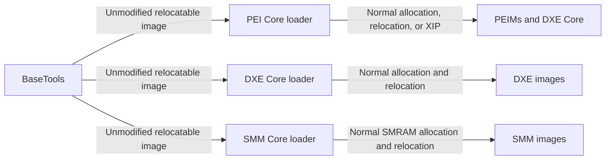

# RFC: Remove Load Module at Fixed Address Support

## Metadata

- **RFC Number**: 0006
- **Title**: Remove Load Module at Fixed Address Support
- **Status**: Draft

## Change Log

- 2026-09-24: Initial RFC created
- 2026-10-13: Expanded the proposal from PEI-only removal to removal from all phases

## Motivation

EDK2's Load Module at Fixed Address (LMFA) feature allows the build system to request preferred addresses for
firmware modules. `PcdLoadModuleAtFixAddressEnable` controls the feature, and BaseTools records each assigned address
in otherwise unused fields in the image section headers. During boot, the PEI, DXE, and SMM PE/COFF loaders decode
those fields and attempt to honor the assigned addresses.

LMFA was introduced to make debugging easier during early platform development. Stable module addresses allowed a
debugger to load symbols before the corresponding module was discovered at runtime. It was not intended to provide a
production firmware requirement or a placement guarantee.

The disclosed use of the feature no longer justifies the maintenance burden for the code base:

- BaseTools classifies, rebases, patches, and reports PEI, DXE boot-time, DXE runtime, and SMM images.
- Firmware cores decode build-tool-private data stored in PE/COFF section headers, reserve address ranges, maintain
  allocation bitmaps, and fall back to normal loading when a requested range cannot be used.
- The implementation spans build parsers, package declarations, PEI Core, DXE Core, SMM Core, SMM IPL, and platform
  configuration.
- Predictable code addresses weaken system security. This is particularly undesirable for privileged SMM code.
- The special path is not covered by a known upstream boot test. During RFC review, testing of the feature was
  reported to cause boot hangs and assertions, indicating that retaining it would also require diagnosis, fixes, and
  dedicated regression coverage. Polling from the EDK2 mailing list did not result in any admitted use of the feature.

LMFA does not guarantee fixed placement. When an assigned address is invalid, unavailable, or overlaps another image,
the loaders fall back to their normal allocation and relocation paths. Modules therefore already need to work without
their assigned addresses.

The original proposal removed LMFA only from PEI. During initial review it was suggested that a survey of consumers
could result in a wider removal. Due to no responses, this RFC now proposes removing LMFA from all phases.

The request for information was posted to the
[edk2-devel mailing list](https://edk2.groups.io/g/devel/topic/121430349) on 2026-09-25. No upstream platform is known
to enable LMFA, and no active downstream dependency has been identified during RFC review. A downstream consumer
identified before implementation will need to migrate its debug workflow rather than retain LMFA as a production
contract.

### Historical Use Cases and Replacements

| Use case | LMFA behavior | Replacement |
|---|---|---|
| Load symbols before a module starts | Predict the module address from the build map | Consume debug logs, status-code module-load records, or debug-agent notifications and load symbols at the reported runtime address |
| Compare addresses across debug boots | Keep modules at build-assigned addresses | Record module-load information with each trace or crash dump and symbolize it during analysis |
| Locate code for platform scripts | Parse the LMFA map or assume the configured top address | Discover loaded images through platform debug-agent interfaces or exported module information |
| Communicate between modules | Depend on a known image address | Use PI protocols, PPIs, HOBs, configuration tables, or another defined interface |
| Execute early code without relocation | Place a PEIM at an assigned RAM address | Use a deliberately XIP-capable image or the normal PEI allocation and relocation path |

These replacements report the address that was actually used and continue to work with memory-layout changes, ASLR,
and loader fallback behavior.

### Cost of Retaining the Feature

Keeping LMFA would require all of the following:

- Repairing the reported boot hangs and assertions.
- Adding boot coverage for absolute-address and top-of-memory-relative configurations in PEI, DXE, and SMM.
- Maintaining the private section-header encoding contract between BaseTools and three firmware loaders.
- Maintaining four generated page-count PCDs, a configuration-table GUID, range reservation, and bitmap state.
- Auditing predictable SMM placement as the SMM threat model and memory protections evolve.
- Preserving platform and build-system configuration that is unused by known upstream platforms.

The feature is disabled by default, so it should not affect production builds that do not enable it. That also means
its code receives little routine validation. Removal eliminates the dormant attack and maintenance surface without
changing the normal loader paths used by those builds.

## Technology Background

LMFA was added to EDK2 in 2010 by
[commit 54ea99a798f7](https://github.com/tianocore/edk2/commit/54ea99a798f7d714b59503fcc21ee97878bc6492).
It supports two configurations:

- A positive `PcdLoadModuleAtFixAddressEnable` value specifies an absolute top address.
- `0xFFFFFFFFFFFFFFFF` specifies addresses as offsets from phase-specific runtime base addresses.

When enabled, BaseTools divides the fixed-address space into PEI, DXE boot-time, DXE runtime, and SMM code regions.
It rebases eligible images, encodes absolute addresses or signed offsets in image section headers, patches generated
page-count PCDs, and emits an LMFA map.

The generated size PCDs are:

- `PcdLoadFixAddressPeiCodePageNumber`
- `PcdLoadFixAddressBootTimeCodePageNumber`
- `PcdLoadFixAddressRuntimeCodePageNumber`
- `PcdLoadFixAddressSmmCodePageNumber`

PEI Core, DXE Core, and SMM Core decode the assigned address and validate the requested range. DXE Core publishes
`EFI_LOAD_FIXED_ADDRESS_CONFIGURATION_TABLE` for DXE and SMM coordination, and SMM IPL supplies the SMRAM base used
for SMM image offsets.

The normal image-loading behavior is already the fallback whenever LMFA cannot be used. Relocatable images are
allocated and relocated by their phase loader, while eligible execute-in-place images continue to execute from their
firmware volume.

Relevant current implementation:

- [PEI image loader](https://github.com/tianocore/edk2/blob/master/MdeModulePkg/Core/Pei/Image/Image.c)
- [PEI dispatcher and permanent-memory setup](https://github.com/tianocore/edk2/blob/master/MdeModulePkg/Core/Pei/Dispatcher/Dispatcher.c)
- [DXE image loader](https://github.com/tianocore/edk2/blob/master/MdeModulePkg/Core/Dxe/Image/Image.c)
- [DXE memory allocation](https://github.com/tianocore/edk2/blob/master/MdeModulePkg/Core/Dxe/Mem/Page.c)
- [DXE GCD memory management](https://github.com/tianocore/edk2/blob/master/MdeModulePkg/Core/Dxe/Gcd/Gcd.c)
- [SMM image dispatcher](https://github.com/tianocore/edk2/blob/master/MdeModulePkg/Core/PiSmmCore/Dispatcher.c)
- [SMM IPL](https://github.com/tianocore/edk2/blob/master/MdeModulePkg/Core/PiSmmCore/PiSmmIpl.c)
- [LMFA configuration table](https://github.com/tianocore/edk2/blob/master/MdeModulePkg/Include/Guid/LoadModuleAtFixedAddress.h)
- [BaseTools fixed-address layout](https://github.com/tianocore/edk2/blob/master/BaseTools/Source/Python/build/build.py)
- [LMFA PCD declarations](https://github.com/tianocore/edk2/blob/master/MdeModulePkg/MdeModulePkg.dec)

## Goals

1. Remove build-assigned fixed-address placement from PEI, DXE, and SMM.
2. Remove the private section-header encoding contract used to communicate LMFA addresses.
3. Remove LMFA-specific PCDs, configuration data, loader state, range reservations, and bitmap management.
4. Remove LMFA rebasing, PCD patching, map generation, and configuration parsing from BaseTools.
5. Preserve normal allocation, relocation, shadowing, execute-in-place, and phase-transition behavior.
6. Provide migration guidance for debug workflows that previously relied on predictable addresses.

## Requirements

1. PEI Core, DXE Core, and SMM Core must no longer decode, validate, reserve, or track build-assigned image addresses.
2. BaseTools must no longer assign or encode fixed addresses for any module type.
3. `PcdLoadModuleAtFixAddressEnable` and all four `PcdLoadFixAddress*CodePageNumber` PCDs must be removed.
4. `EFI_LOAD_FIXED_ADDRESS_CONFIGURATION_TABLE` and its GUID can be removed.
5. `FIX_LOAD_TOP_MEMORY_ADDRESS` must no longer be accepted as a DSC build option.

## UEFI/PI Specification Impact

This change has no UEFI or PI specification impact. LMFA, its PCDs, its build option, its configuration table, and its
image section-header encoding are EDK2 implementation details. The PI image-loading interfaces do not require a
firmware core to load an image at a build-assigned address.

No Code First issue is required.

## Backward Compatibility

This is a breaking change for any platform, debugger configuration, or script that depends on a PEI, DXE, or SMM
module executing at an address assigned by BaseTools, or defines the associated PCDs.

- **Breaking changes**: BaseTools will no longer assign fixed addresses or produce an LMFA map.
  `PcdLoadModuleAtFixAddressEnable`, all `PcdLoadFixAddress*CodePageNumber` PCDs, the
  `EFI_LOAD_FIXED_ADDRESS_CONFIGURATION_TABLE`, and `FIX_LOAD_TOP_MEMORY_ADDRESS` will be removed.
- **Unaffected behavior**: Builds that do not enable LMFA will continue to use the same normal phase-specific
  allocation, relocation, shadowing, and XIP paths.
- **Migration path**: Platforms must remove LMFA configuration and stop relying on build-time image addresses.
  Debuggers and tooling must obtain actual image addresses from debug logs, module-load records, debug-agent
  interfaces, or postmortem data.
- **Deprecation**: Removal will follow the EDK2 breaking-change process. No compatibility layer is proposed because
  retaining the encoding, generated PCDs, or loader branches would retain the cross-layer contract this RFC removes.

## Platform/Package Impact

The implementation inventory below identifies the known surfaces that must be updated. The implementation series
must also use repository-wide symbol searches to catch references added after this RFC is accepted.

- **MdeModulePkg declarations and shared definitions**
  - Remove `PcdLoadModuleAtFixAddressEnable`,
    `PcdLoadFixAddressPeiCodePageNumber`, `PcdLoadFixAddressBootTimeCodePageNumber`,
    `PcdLoadFixAddressRuntimeCodePageNumber`, and `PcdLoadFixAddressSmmCodePageNumber` from
    `MdeModulePkg.dec` and their strings from `MdeModulePkg.uni`.
  - Remove `MdeModulePkg/Include/Guid/LoadModuleAtFixedAddress.h`, the GUID declaration and registration, and its
    `Maintainers.txt` entry.
  - Remove LMFA PCD and GUID dependencies from affected INF files.
- **PEI Core**
  - Update `MdeModulePkg/Core/Pei/Image/Image.c`, `Dispatcher/Dispatcher.c`, `PeiMain/PeiMain.c`, `PeiMain.h`, and
    `PeiMain.inf`.
  - Remove assigned-address decoding, PEI range reservation, usage bitmap state, and PEI/DXE Core fixed placement.
- **DXE Core**
  - Update `MdeModulePkg/Core/Dxe/Image/Image.c`, `Mem/Page.c`, `Gcd/Gcd.c`, `DxeMain/DxeMain.c`, `DxeMain.h`, and
    `DxeMain.inf`.
  - Remove assigned-address decoding, DXE range reservation, usage bitmap state, and publication of the LMFA
    configuration table.
- **SMM Core and SMM IPL**
  - Update `MdeModulePkg/Core/PiSmmCore/Dispatcher.c`, `Pool.c`, `PiSmmIpl.c`, `PiSmmCore.h`,
    `PiSmmCore.inf`, and `PiSmmIpl.inf`.
  - Remove assigned-address decoding, SMM range reservation, usage bitmap state, SMRAM-base handoff for LMFA, and
    LMFA configuration-table consumption.
- **BaseTools**
  - Remove LMFA module classification, address assignment, image rebasing, PCD patching, and map generation from
    `BaseTools/Source/Python/build/build.py`.
  - Remove `FIX_LOAD_TOP_MEMORY_ADDRESS` parsing and data-model constants from
    `BaseTools/Source/Python/Common/DataType.py`, `Workspace/MetaFileParser.py`, `Workspace/DscBuildData.py`, and
    their UPT and ECC counterparts.
  - Remove or update LMFA-specific tests and documentation.
- **Platforms and external tooling**
  - Remove `FIX_LOAD_TOP_MEMORY_ADDRESS`, LMFA PCD settings, and assumptions about addresses in scripts, debugger
    configuration, measurements, and inter-module communication.
  - No source changes are expected for known upstream platforms because none are known to enable the feature.

## Resolved Design Decisions

- LMFA will be removed from **all phases**, not only PEI.
- DXE Core will not retain special fixed placement.
- All LMFA PCDs, the configuration table, the BaseTools build option, and the LMFA map will be removed rather than
  retained as unused compatibility interfaces.
- Debug use cases will migrate to runtime module discovery and symbol loading.
- Reported boot hangs and assertions will not be fixed as a prerequisite to removal. They are evidence of the
  maintenance cost of the untested path; normal loader paths will be validated instead.

## Prior Art/Related Work

Standalone MM Core removed LMFA support in
[tianocore/edk2#5168](https://github.com/tianocore/edk2/pull/5168). That change established precedent for removing
phase-specific LMFA support.

Each affected firmware core already has a normal page-allocation and relocation path. This RFC makes those existing
paths the only loading behavior rather than introducing a new replacement loader.

## Alternatives

### Alternative 1: Keep and Repair LMFA

- **Pros**: Preserves existing debug workflows and avoids downstream migration.
- **Cons**: Requires diagnosing the reported hangs and assertions, adding sustained coverage for every phase and
  configuration mode, retaining predictable SMM addresses, and maintaining the private BaseTools-to-loader contract.
- **Why not chosen**: No active consumer has been identified to justify the security, test, and maintenance costs.

### Alternative 2: Remove LMFA Only from PEI

- **Pros**: Removes PEI bitmap and permanent-memory complexity with a smaller immediate compatibility impact.
- **Cons**: Retains most BaseTools machinery, all shared configuration, the DXE and SMM loader branches, and
  predictable SMM placement.
- **Why not chosen**: Review concluded that, absent current users, partial removal preserves most of the cost and
  leaves the most security-sensitive use intact.

### Alternative 3: Keep Fixed Placement for DXE Core Only

- **Pros**: Preserves a stable address for the earliest DXE code.
- **Cons**: PEI Core and BaseTools must retain special address encoding and loading for DXE Core, so the cross-layer
  contract cannot be removed.
- **Why not chosen**: No upstream or downstream requirement for fixed DXE Core placement has been identified.

### Alternative 4: Retain Deprecated Interfaces as No-Ops

- **Pros**: Existing DSC files continue to parse.
- **Cons**: Silently changes requested behavior, leaves dead public configuration in place, and can make a build look
  successfully configured when fixed placement is not occurring.
- **Why not chosen**: Stale configuration must fail explicitly so consumers can migrate intentionally.

## Implementation Design

### Architecture Overview

After this change, BaseTools does not assign load addresses. Each firmware core uses its normal loader.



No phase reserves an LMFA code region, decodes an address from a section header, or maintains an LMFA allocation
bitmap.

### Detailed Design

1. **Remove PEI fixed-placement logic**
   - Remove `CheckAndMarkFixLoadingMemoryUsageBitMap()` and
     `GetPeCoffImageFixLoadingAssignedAddress()` from the PEI loader.
   - Remove the LMFA branch from the PEI PE/COFF load path.
   - Remove PEI usage-bitmap state and fixed PEI code-page allocation.
   - Load PEIMs and DXE Core through the existing normal allocation, relocation, or XIP paths.

2. **Remove DXE fixed-placement logic**
   - Remove the DXE versions of `CheckAndMarkFixLoadingMemoryUsageBitMap()` and
     `GetPeCoffImageFixLoadingAssignedAddress()`.
   - Remove LMFA address-range reservation and bitmap initialization from DXE memory management.
   - Remove the LMFA branch from the DXE image loader.
   - Stop publishing `EFI_LOAD_FIXED_ADDRESS_CONFIGURATION_TABLE`.

3. **Remove SMM fixed-placement logic**
   - Remove the SMM versions of `CheckAndMarkFixLoadingMemoryUsageBitMap()` and
     `GetPeCoffImageFixLoadingAssignedAddress()`.
   - Remove LMFA address-range reservation and bitmap state from SMM Core.
   - Remove the LMFA branch from the SMM dispatcher and use normal SMRAM allocation and relocation.
   - Remove the SMM IPL handoff of LMFA SMRAM-base information.

4. **Remove shared declarations and module dependencies**
   - Remove all five LMFA PCDs and their localized descriptions.
   - Remove `EFI_LOAD_FIXED_ADDRESS_CONFIGURATION_TABLE` and
     `gLoadFixedAddressConfigurationTableGuid`.
   - Remove affected PCD and GUID entries from PEI Core, DXE Core, SMM Core, and SMM IPL INF files.
   - Remove LMFA-only fields, globals, and constants once their consumers are gone.

5. **Remove BaseTools support**
   - Stop classifying modules into LMFA regions and collecting images for fixed-address rebasing.
   - Stop calculating PEI, DXE boot-time, DXE runtime, and SMM LMFA page counts.
   - Stop patching LMFA PCDs and encoding addresses or offsets into image section headers.
   - Remove LMFA map generation and its console message.
   - Remove `FIX_LOAD_TOP_MEMORY_ADDRESS` from DSC parsing, workspace data, and related constants.
   - During the deprecation window, diagnose the setting as deprecated; after removal, reject it as unsupported.

6. **Update documentation and tests**
   - Remove BaseTools documentation for LMFA configuration and map output.
   - Update debugging guidance to use runtime module-load information.
   - Remove LMFA-specific tests and add coverage that prevents its PCDs, GUID, build option, and section-header
     encoding from being reintroduced accidentally.

### Configuration Migration Example

Platforms must delete the shared LMFA setting:

```diff
 [PcdsFixedAtBuild]
-  gEfiMdeModulePkgTokenSpaceGuid.PcdLoadModuleAtFixAddressEnable|0xFFFFFFFFFFFFFFFF
```

They must also delete any LMFA page-count overrides:

```diff
 [PcdsPatchableInModule]
-  gEfiMdeModulePkgTokenSpaceGuid.PcdLoadFixAddressPeiCodePageNumber|0
-  gEfiMdeModulePkgTokenSpaceGuid.PcdLoadFixAddressBootTimeCodePageNumber|0
-  gEfiMdeModulePkgTokenSpaceGuid.PcdLoadFixAddressRuntimeCodePageNumber|0
-  gEfiMdeModulePkgTokenSpaceGuid.PcdLoadFixAddressSmmCodePageNumber|0
```

Any `FIX_LOAD_TOP_MEMORY_ADDRESS` statement must also be removed. There is no replacement LMFA PCD or build option.

## Testing Strategy

1. Build Ovmf platforms and verify systems still boot.
2. Run package CI and basetools builds to verify no breaks.
3. Verify DXE boot-time and runtime drivers use normal DXE allocation and relocation.
4. Verify SMM Core and SMM drivers use normal SMRAM allocation and relocation.
5. Verify builds fail with a clear diagnostic when a DSC still contains removed PCDs.
6. Verify generated images are not rebased for LMFA, contain no LMFA address encoding, and produce no LMFA map.
7. Add or update BaseTools tests for removal of the build option, module classification, PCD patching, and map output.
8. Create ed2-platforms PRs to address an build breaks.

The reported LMFA boot hangs and assertions do not need to be reproduced or fixed because the failing path is being
removed. Testing must instead demonstrate that the same platforms boot through their normal loader paths after LMFA
configuration is deleted.

## Migration/Adoption Plan

1. **Phase 1 - Announce deprecation**: Publish the accepted RFC and breaking-change notice. Ask downstream consumers
   to report any remaining dependency on fixed addresses and document runtime symbol-loading alternatives.
2. **Phase 2 - Remove all LMFA support**: Merge coordinated BaseTools and MdeModulePkg changes, remove all LMFA
   declarations and loader branches, and publish migration guidance in the release notes.

The exact stable tags will be selected through the EDK2 breaking-change process. The implementation should land
early in a development cycle to maximize platform validation time.

## Guide-Level Explanation

### For Platform Developers

Platforms that do not enable LMFA require no configuration changes.

Platforms that enable LMFA must:

1. Remove LMFA assumptions and PCD declarations.
2. Check scripts, debugger configuration, measurements, and inter-module communication for fixed-address assumptions.
3. Configure debuggers and symbolization tools to consume runtime module-load information.
4. Validate PEI, DXE, runtime, and SMM behavior using the normal phase loaders.

### For End Users (if applicable)

No user-visible firmware behavior is expected. This is an internal build and image-loading change. Firmware images
should continue to boot normally, but module runtime addresses may differ between builds or boots.
