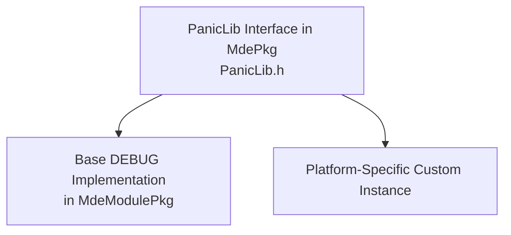

# RFC: Introduce PanicLib

## Metadata

- **RFC Number**: 000
- **Title**: Introduce PanicLib
- **Status**: Draft

## Change Log

- 2026-07-22: Initial RFC created
- 2026-10-13: Incorporated review feedback

## Motivation

EDK2 handles catastrophic initialization failures with inconsistent combinations of `ASSERT()`, `DEBUG()`, and
`CpuDeadLoop()`. Diagnostics may omit source information or disappear when debug output is disabled.

Early boot needs a small, reliable interface that reports the source file and line when possible, then terminates
execution. It must work before most firmware services are available.

## Technology Background

EDK2 runs across SEC, PEI, DXE, and MM, where different services are available. PanicLib follows the existing library
class model so platforms can select a phase-appropriate implementation in their DSC files.

## Goals

1. Provide a consistent interface for unrecoverable initialization failures.
2. Include the source filename and line number in diagnostics.
3. Remain lightweight enough for SEC and PEI.
4. Leave recoverable failures on existing error paths.

## Requirements

1. Define a public PanicLib library class in MdePkg.
2. Provide a base implementation that reports through `DEBUG()` and calls `CpuDeadLoop()`.
3. Avoid dynamic allocation and complex dependencies.
4. Allow platform-specific implementations.
5. Require every consuming build configuration to select a concrete implementation. Neither build type nor
   `MDEPKG_NDEBUG` may disable panic behavior.
6. Require `PanicReport()` to receive non-null `FileName` and `Description` values and never return.
7. Allow implementation-defined nested or reentrant behavior, but never permit a panic invocation to return.

## UEFI/PI Specification Impact

PanicLib is an EDK2 implementation detail and requires no UEFI or PI specification changes.

## Backward Compatibility

- Existing modules are unaffected until they consume PanicLib.
- Adoption is incremental; existing fatal paths may coexist during migration.
- Every consumer must resolve the base or a platform-specific implementation. No null implementation is provided.

## Platform/Package Impact

- **MdePkg**: New library class header and declaration.
- **MdeModulePkg**: Base implementation using `DEBUG()` output and a dead loop.
- **Platforms**: Select the base implementation or provide a custom implementation, with corresponding DSC/FDF
  integration updates.
- **Build tooling**: No tooling changes.

## Panic Usage Policy

Use `PANIC()` only when required firmware initialization fails, no recovery or error-propagation path exists, and
continuing would leave the system in an undefined or insecure state.

Examples include:

- MM initialization fails after beginning a security-sensitive transition and recovery would leave SMRAM or another
  MM protection unlocked.
- Required processors fail to initialize, leaving the system without the CPU state needed to continue safely.
- A required initialization invariant fails, making the resulting state unsafe for later phases.

Do not use `PANIC()` when the error can be returned, retried, rolled back, or isolated by disabling an optional
feature. This normally excludes failures in late DXE and optional-feature drivers.

Existing `ASSERT()` plus `CpuDeadLoop()` call sites must be evaluated individually:

- Convert to `PANIC()` only when the call site meets all of the criteria above in every build type.
- Keep `ASSERT()` for development-time contract checks that do not require fatal behavior in release builds.
- Convert to an `EFI_STATUS` or another error-reporting path when a caller can recover or make a policy decision.

## Review Responsibility

`PANIC()` needs no special review beyond the package's normal process. The package owner determines eligibility
because they understand the available recovery paths. A change introducing `PANIC()` should explain what failed and
why execution cannot continue safely.

## Prior Art/Related Work

- [mu_basecore PanicLib Implementation](https://github.com/microsoft/mu_basecore/blob/release/202511/MdePkg/Include/Library/PanicLib.h)
- [EDK2 Library Classes Documentation](https://github.com/tianocore/edk2/blob/master/Readme.rst)
- [UEFI Platform Initialization Specification](https://uefi.org/sites/default/files/resources/UEFI%20PI%201.8%20Errata%20A.pdf)
- Existing EDK2 patterns using ASSERT/DEBUG plus `CpuDeadLoop()` in catastrophic paths.

## Alternatives

### Alternative 1: Continue using ASSERT/DEBUG plus local dead-loop logic

- **Pros**: No new library class required.
- **Cons**: Behavior and diagnostics remain inconsistent, and output may be compiled out.
- **Why not chosen**: It does not provide a consistent fatal-error interface.

### Alternative 2: Introduce a richer panic framework with callbacks/policies

- **Pros**: More flexibility.
- **Cons**: More complexity and dependencies, especially in SEC and PEI.
- **Why not chosen**: Early boot needs a small primitive.

### Alternative 3: Implement PANIC into DebugLib

- **Pros**: Reuses the existing diagnostic interface and its platform-selected output implementation.
- **Cons**:
  - Custom panic behavior would require replacing the entire DebugLib instance.
  - A null DebugLib or `MDEPKG_NDEBUG` could disable the panic operation with its diagnostics.
- **Why not chosen**: PanicLib may use `DEBUG()` for output, but termination must remain independent of DebugLib.

### Alternative 4: Require all panics to use a CPU exception or interrupt

- **Pros**:
  - A dedicated handler can use an independent stack and capture architecture-specific context.
- **Cons**:
  - Exception and interrupt infrastructure availability varies by phase and architecture (SEC/PEI/DXE/MM).
  - It adds complexity for platforms that only need a diagnostic followed by a halt or reset.
- **Why not chosen**:
  - The platform-selected PanicLib instance chooses the mechanism. It may report and halt, reset, or raise an
    exception or interrupt.
  - Platforms that must tolerate a compromised stack should use an exception- or interrupt-based instance with an
    independent stack.

## Implementation Design

This RFC introduces a simple PanicLib interface plus a macro convenience wrapper.

### Architecture Overview



### Detailed Design

#### Core API

Function declaration:

```c
VOID
EFIAPI
PanicReport (
  IN CONST CHAR8  *FileName,
  IN UINTN        LineNumber,
  IN CONST CHAR8  *Description
);
```

`FileName` and `Description` are required and must not be `NULL`.

`PanicReport()` must halt, reset, or transfer control to a handler that does so. It must never return.

Nested and reentrant panic behavior is implementation-defined. An implementation may emit reduced diagnostics or
terminate immediately, but a nested or reentrant invocation must not return.

Convenience macro:

```c
#define PANIC(Message) \
  do { \
    PanicReport (__FILE__, __LINE__, (Message)); \
    ANALYZER_UNREACHABLE (); \
  } while (FALSE)
```

#### Output Format

Panic messages use this standardized format:

```text
PANIC <FileName>(<LineNumber>): <Description>
```

Example:

```text
PANIC UefiCpuPkg/CpuMpPei/CpuMpPei.c(58): Failed to get processor number when initializing the stack switch exception handlers.
```

#### Implementation Strategy

1. **Phase 1 (MdePkg)**: Add `MdePkg/Include/Library/PanicLib.h`.
2. **Phase 2 (MdeModulePkg)**: Add `MdeModulePkg/Library/BasePanicLib/` (`DEBUG()` implementation).
3. **Phase 3 (Platform Adoption)**: Platforms select the base instance or provide a custom instance for every build
   configuration that consumes PanicLib.

#### Recommended Error Message Style

- Pass a fixed string literal. `PANIC()` does not support variadic formatting or runtime values.
- Use direct language that identifies the failed invariant or required dependency.
- Keep messages short and actionable.
- Avoid generic phrases such as "unexpected error".

### Code Examples

The following function checks the processor-number lookup before using the result to select the processor's
exception-stack context. If the lookup fails, the callback cannot safely continue initializing that processor's
stack-switch exception handlers.

```c
VOID
EFIAPI
InitializeExceptionStackSwitchHandlers (
  IN OUT VOID  *Buffer
  )
{
  EXCEPTION_STACK_SWITCH_CONTEXT  *SwitchStackData;
  UINTN                           Index;
  EFI_STATUS                      Status;

  Status = MpInitLibWhoAmI (&Index);
  if (EFI_ERROR (Status)) {
    PANIC ("Failed to get processor number when initializing the stack switch exception handlers.");
  }

  SwitchStackData = (EXCEPTION_STACK_SWITCH_CONTEXT *)Buffer;

  if ((SwitchStackData[Index].Status == EFI_NOT_STARTED) || (SwitchStackData[Index].Status == EFI_BUFFER_TOO_SMALL)) {
    SwitchStackData[Index].Status = InitializeSeparateExceptionStacks (SwitchStackData[Index].Buffer, &SwitchStackData[Index].BufferSize);
  }
}
```

Base implementation:

```c
#include <Library/BaseLib.h>
#include <Library/DebugLib.h>
#include <Library/PanicLib.h>

VOID
EFIAPI
PanicReport (
  IN CONST CHAR8  *FileName,
  IN UINTN        LineNumber,
  IN CONST CHAR8  *Description
)
{
  DEBUG ((
    DEBUG_ERROR,
    "PANIC %a(%u): %a\n",
    FileName,
    (UINT32)LineNumber,
    Description
    ));

  CpuDeadLoop ();
}
```

The base implementation uses the platform's selected DebugLib instance for best-effort diagnostics. `DEBUG()` may
produce no output in some build configurations, but `CpuDeadLoop()` remains present and preserves the non-returning
panic behavior.

## Testing Strategy

1. Build the base implementation in representative debug and release configurations, including configurations that
   define `MDEPKG_NDEBUG`.
2. Integration tests across representative SEC/PEI/DXE/MM call sites where practical.
3. Validate that `MDEPKG_NDEBUG` or a DebugLib instance that produces no output suppresses only the diagnostic. The
   base PanicLib implementation must still reach `CpuDeadLoop()` and remain non-returning.
4. Regression tests confirming existing non-panic error paths remain unchanged.

Platforms are responsible for validating custom instances. Normal library-class resolution fails the build if a
consumer has no instance.

## Migration/Adoption Plan

1. Land the interface and base implementation.
2. Incrementally convert initialization failures that meet the Panic Usage Policy.
3. Let platforms select the base instance or add a custom instance as needed.

## Guide-Level Explanation

### For Package Developers

- Use `PANIC()` only for unrecoverable initialization failures that would leave the system unable to continue safely.
- Use precise, actionable panic descriptions.
- Keep recoverable errors and optional-feature failures on normal status-return paths.

### For Platform Developers

- Choose base implementation or provide a custom PanicLib instance.
- Integrate via standard library-class resolution in DSC/FDF.
- Ensure the selected implementation halts or resets the system and never returns to the panic call site.
